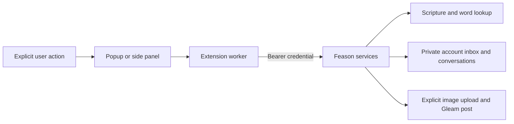

# Feason — Study & Share

A Manifest V3 Chrome extension that posts to Feason's existing Gleam API from
the toolbar, the `Command/Ctrl + Shift + G` shortcut, or a page/link/selection
context menu.

Version 1.2 follows the iOS Gleam composer: Cormorant Garamond headings,
EB Garamond writing, DM Sans controls, category-colored rooms, stained-glass
capsules, and a dark writing pane. All fonts and their licenses are bundled;
the popup makes no font requests to external services.

## Study companion

Choose **Keep open** for a persistent sidebar with Scripture, Ask Feasy, Inbox,
Words, and Gleam. Context-menu selections prepare a tool; they never submit a
question, save, or post automatically. Feasy uses the account’s existing
allowance and sends a bounded excerpt with your question. Sources are the
passages actually cited; grounding checks are shown without claiming infallibility.

Scripture lookup uses the public-domain WEB translation. Word lookup is read-only
and includes supplied provenance and occurrence links. Private inbox items sync
to Feason’s website, including mobile browsers; they are not encrypted journal
entries. The native iOS app is a design reference, not a new inbox client.

Resource Gleams can include an image up to 5 MB. Images remain local until Post.
All Gleam kinds can carry a verse anchor. Preview shows the exact text, source,
image, and anchor before an explicit post. Session drafts also preserve these.



The client has no page content script or background browsing-history collection.
The static client depends on Feason’s authenticated service; it does not run a
standalone backend or an offline Scripture corpus. Real Chrome OAuth, side-panel
permissions, and live account writes require installed-browser acceptance testing.

## Local installation

1. Use Chrome 116 or later. The extension connects to the existing Feason
   authentication and Gleam endpoints at `https://www.feason.com`.
2. Open `chrome://extensions`, enable **Developer mode**, and choose
   **Load unpacked**.
3. Select this `extension` directory.
4. Pin **Feason — Study & Share** and sign in from its popup.

The manifest's public key gives unpacked builds the stable extension ID
`omkblpgeonilpgkdgieiingkigkhhfhn`. The server also accepts the original
unpacked ID, `pmdfpoeningpholpemfjffidcibhchao`. When updating an existing
unpacked install, preserve its public key and reload the extension in Chrome.
No private key or Feason credential is bundled.

## Sign-in and drafts

The background worker completes sign-in even when Chrome closes the toolbar
popup. It validates the callback origin, path, and state before storing a token.
Posting also runs in the worker; reopening the popup shows the saved receipt
instead of offering the accepted Gleam again. Failed requests are never retried
automatically.

Unsent text, attribution, and the optional attached page stay in Chrome session
storage when the popup closes. Sign-out clears this draft and the local token.
Switching to a shorter category keeps the text and explains the limit. The
attached page can be removed before posting. URL-only resource Gleams work.

## Chrome Web Store release

Chrome Web Store assigns the production extension ID. After the first package
upload:

1. Create an ID-reservation package at version `0.0.1` without the development
   key:

   ```sh
   npm run extension:package -- --reserve-id /tmp/feason-extension-0.0.1.zip
   ```

2. Upload it as a draft, then copy the public key shown in the listing's
   **Package** tab into `manifest.json`.
3. Set `FEASON_CHROME_EXTENSION_ID` in the Feason deployment to the listing ID.
4. Build the final package, verify its unpacked ID matches the listing, then
   upload it:

   ```sh
   npm run extension:package -- /tmp/feason-extension-1.2.0.zip
   ```

Store copy, permission justifications, privacy disclosure, and reviewer steps
live in `STORE_LISTING.md`.

The server accepts the two known unpacked identities and one optionally
configured production identity. Each callback uses its allowlisted
`chromiumapp.org` host. Never accept an arbitrary redirect URL.

## Verification

From this repository root (Node 24 or later):

```sh
npm ci
npm test
```

The tests exercise the actual popup and worker with synthetic Chrome APIs:
callback validation, popup closure, posting, expired sign-ins, drafts, category
limits, attribution, source removal, and sign-out. The packaging test unzips the
release and follows every runtime import and asset reference to catch missing
modules, logos, or fonts. Real Chrome OAuth and live posting still require an
installed extension and a signed-in Feason account.

The extension is static and has no separate dependency install or compile step.
